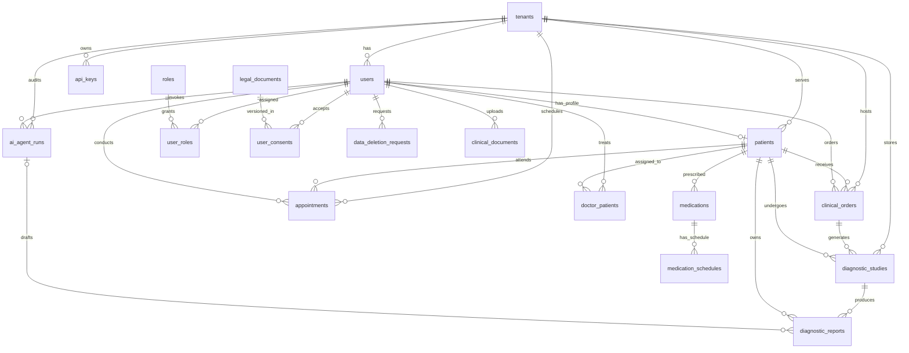

# Diagrama Entidad-Relación (ER) — Higea

Base de datos relacional normalizada en **Tercera Forma Normal (3FN)** implementada en **MySQL** con **Sequelize**.

## Dominios de Datos
1. **Seguridad y Multi-Tenancy**: `tenants`, `users`, `roles`, `user_roles`, `api_keys`
2. **Gestión Clínica y Farmacológica**: `patients`, `doctor_patients`, `clinical_orders`, `diagnostic_studies`, `diagnostic_reports`, `medications`, `medication_schedules`, `appointments`
3. **Trazabilidad de IA, RAG e Integraciones**: `ai_agent_runs`, `clinical_documents`, `external_api_logs`, `exchange_rates`
4. **Gobernanza de Datos (Ley N.º 8968)**: `legal_documents`, `user_consents`, `data_deletion_requests`

## Cardinalidades Clave
- `users` ↔ `roles`: **N:M** mediante `user_roles` (clave única compuesta `user_id, role_id`).
- `users` (médicos) ↔ `patients`: **N:M** mediante `doctor_patients`.
- `users` ↔ `patients`: **1:1** (`patients.user_id` único).
- `tenants` → `api_keys`: **1:N** (cada clínica puede rotar o revocar múltiples llaves).
- `diagnostic_studies` → `diagnostic_reports`: **1:N** con flujo obligatorio `pending_validation` → `approved` (validado por un médico).
- `medications` → `medication_schedules`: **1:N** (horarios mañana/tarde/noche).
- `legal_documents` → `user_consents`: **1:N** (trazabilidad de aceptación por versión de Política de Privacidad y Términos).
